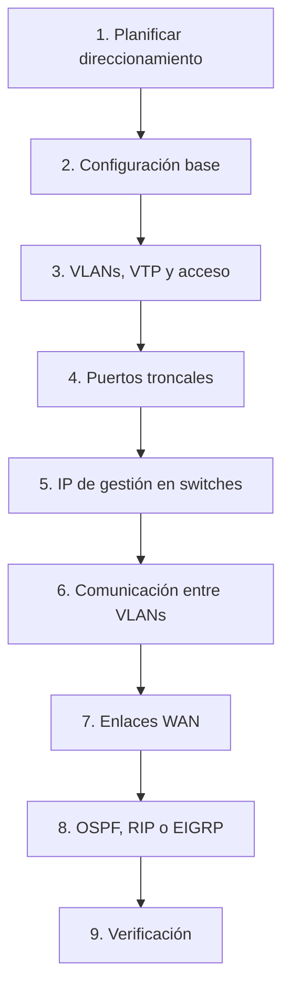
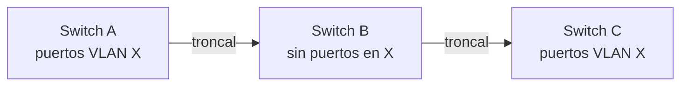
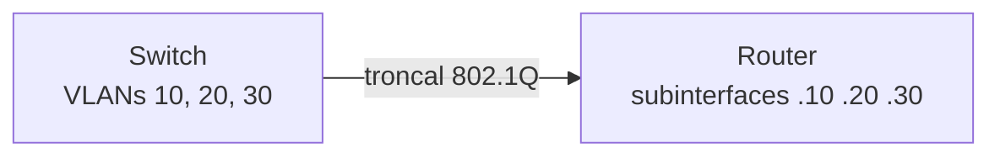

# Guía instructiva: VLANs, troncales y enrutamiento dinámico (OSPF, RIP y EIGRP)

## Introducción y convenciones

Esta guía lleva una red desde cero hasta tener VLANs, troncales, comunicación entre VLANs y enrutamiento dinámico (OSPF, RIP o EIGRP), configurando solo switches y routers Cisco IOS. Los equipos cliente (PCs, laptops, servidores) quedan fuera; solo se asume que cada uno lleva IP, máscara y gateway de su VLAN.

El orden importa: cada fase depende de la anterior. Si saltas una, la siguiente puede parecer correcta y aun así no funcionar.



Cada fase termina con un bloque **Verifica** que confirma que lo hecho funciona antes de avanzar.

### Modos de la línea de comandos

Cada modo tiene su prompt y sus comandos. Si un comando da `Invalid input`, casi siempre estás en el modo equivocado o en el tipo de equipo equivocado (por ejemplo, VTP no existe en routers).

| Modo | Prompt | Cómo entrar | Para qué sirve |
| --- | --- | --- | --- |
| Usuario | `Equipo>` | Al conectarte | Consultas básicas |
| Privilegiado | `Equipo#` | `enable` | `show`, `copy`, `ping` |
| Configuración global | `Equipo(config)#` | `configure terminal` | Comandos que afectan a todo el equipo |
| Interfaz | `Equipo(config-if)#` | `interface <INTERFAZ>` | Configurar un puerto |
| Rango de interfaces | `Equipo(config-if-range)#` | `interface range <INTERFAZ_INICIAL> - <NUMERO_FINAL>` | Configurar varios puertos a la vez |
| Línea | `Equipo(config-line)#` | `line console 0` | Contraseñas de acceso |
| Protocolo de enrutamiento | `Equipo(config-router)#` | `router ospf <ID_PROCESO>` | Configurar OSPF, RIP o EIGRP |

Para salir: `exit` sube un nivel y `end` (o Ctrl+Z) vuelve directo al modo privilegiado.

### Convenciones de esta guía

Todo lo que va entre `< >` es un valor que debes reemplazar, sin escribir los símbolos `<` ni `>`.

| Marcador | Qué poner |
| --- | --- |
| `<ID_VLAN>` | Número de VLAN (1-4094; en switches básicos suele bastar 2-1001) |
| `<NOMBRE_VLAN>` | Nombre corto sin espacios |
| `<RED>` | Dirección de red, por ejemplo la que termina en `.0` |
| `<MASCARA>` | Máscara en decimal (`255.255.255.0`) |
| `<WILDCARD>` | Máscara inversa (`0.0.0.255`) |
| `<IP_ROUTER>` | IP del router en esa red (gateway de la VLAN) |
| `<IP_SWITCH>` | IP de gestión del switch |
| `<INTERFAZ>` | Puerto completo, por ejemplo `GigabitEthernet0/1` o `Serial0/0/0` |
| `<DOMINIO_VTP>` / `<CLAVE_VTP>` | Nombre de dominio y contraseña de VTP |
| `<ID_PROCESO>` | Número de proceso OSPF |
| `<AS>` | Número de sistema autónomo de EIGRP |

### Dos reglas antes de empezar

- **VTP y `switchport` solo existen en switches.** En routers se usan subinterfaces y `encapsulation dot1Q`.
- **Verifica después de cada fase.** Un error de la fase 3 que descubres en la fase 8 cuesta mucho más de encontrar.

Los comandos corresponden a Cisco IOS (probados en la lógica de Packet Tracer). Los nombres de los puertos cambian según el modelo: confírmalos siempre con `show ip interface brief` en routers y `show interfaces status` en switches.

## Fase 1: Planificación del direccionamiento

Antes de escribir un comando, define en tablas qué VLANs, redes e IPs vas a usar: la mayoría de errores de laboratorio nacen de improvisar el direccionamiento. Esta fase no se hace en los equipos, se hace en papel o en una hoja de cálculo.

### Paso 1.1: Define el plan de VLANs

Crea una tabla con una fila por VLAN. Regla de oro: **una VLAN = una subred = un gateway**.

| `ID_VLAN` | `NOMBRE_VLAN` | RED / prefijo | MASCARA | `IP_ROUTER` (gateway) | Switches donde existe |
| --- | --- | --- | --- | --- | --- |
| `<ID>` | `<NOMBRE>` | `<RED>/<PREFIJO>` | `<MASCARA>` | `<IP_ROUTER>` | Todos los que la necesiten |

Criterios para llenarla:

- Usa una convención fija para el gateway (por ejemplo, la primera IP utilizable, `.1`) en todas las VLANs.
- Numera las redes de forma que se relacionen con el ID de la VLAN; así una IP delata su VLAN.
- Reserva una VLAN aparte para la **administración de los switches**, con su propia subred pequeña.
- No uses la VLAN 1 para datos de usuarios; es la VLAN por defecto y no se puede borrar.

### Paso 1.2: Elige el tamaño de cada subred

Calcula los hosts útiles con la fórmula: hosts útiles = 2^(32 − prefijo) − 2 (se restan la dirección de red y la de broadcast).

| Prefijo | Máscara | Wildcard | Hosts útiles | Uso típico |
| --- | --- | --- | --- | --- |
| /24 | 255.255.255.0 | 0.0.0.255 | 254 | LAN de usuarios |
| /27 | 255.255.255.224 | 0.0.0.31 | 30 | LAN mediana |
| /28 | 255.255.255.240 | 0.0.0.15 | 14 | Centro de datos pequeño |
| /29 | 255.255.255.248 | 0.0.0.7 | 6 | Gestión de switches |
| /30 | 255.255.255.252 | 0.0.0.3 | 2 | Enlace punto a punto (WAN) |

La wildcard es la máscara invertida: `255.255.255.255` menos la máscara. La necesitarás en OSPF y EIGRP.

### Paso 1.3: Divide el bloque WAN en subredes /30

Cada enlace entre dos routers necesita su propia red con solo dos IPs. Si tu bloque resumido es `<BLOQUE>.0`, sácale /30 consecutivas: el último octeto avanza de 4 en 4.

| Enlace | Red | IP extremo 1 | IP extremo 2 | Broadcast |
| --- | --- | --- | --- | --- |
| 1 | `<BLOQUE>.0/30` | `.1` | `.2` | `.3` |
| 2 | `<BLOQUE>.4/30` | `.5` | `.6` | `.7` |
| 3 | `<BLOQUE>.8/30` | `.9` | `.10` | `.11` |
| 4 | `<BLOQUE>.12/30` | `.13` | `.14` | `.15` |

La ventaja de partir de un bloque contiguo es que un solo `network` (o una sola ruta resumida) cubre todos los enlaces.

### Paso 1.4: Dimensiona la red de gestión

La subred de gestión debe alcanzar para **1 IP de gateway + 1 IP por switch**. Con /29 tienes 6 utilizables: el router usa una y quedan 5 para switches. Si tienes más switches, sube a /28.

### Paso 1.5: Arma la tabla de interfaces

Es la tabla que consultarás en cada fase: una fila por cada puerto usado.

| Equipo | Interfaz | Conecta con | IP / Máscara | Rol |
| --- | --- | --- | --- | --- |
| `<SWITCH>` | `<INTERFAZ>` | `<EQUIPO_VECINO>` | (sin IP) | Troncal / Acceso a VLAN `<ID>` |
| `<ROUTER>` | `<INTERFAZ>` | `<ROUTER_VECINO>` | `<IP>` `<MASCARA>` | WAN (DCE o DTE) / Subinterfaz |

Si ya tienes la topología armada y no sabes qué cable va a dónde, activa CDP y consulta a los vecinos:

```
enable
configure terminal
cdp run
end
show cdp neighbors
```

**Verifica esta fase:** ninguna red se solapa con otra (IOS rechazará una IP con el mensaje `overlaps with`), cada VLAN tiene su gateway definido y cada enlace WAN tiene exactamente dos IPs.

## Fase 2: Configuración base de todos los equipos

Esta fase es idéntica en switches y routers y se repite en cada equipo antes de tocar VLANs o rutas. Un equipo con nombre propio y acceso protegido evita confundirlos después, cuando tengas ocho ventanas abiertas.

### Paso 2.1: Entra al modo de configuración

```
enable
configure terminal
```

### Paso 2.2: Ponle nombre al equipo

Usa el nombre exacto que indique tu diagrama o enunciado, sin espacios.

```
hostname <NOMBRE_EQUIPO>
```

El prompt cambia de inmediato a `<NOMBRE_EQUIPO>(config)#`.

### Paso 2.3: Protege el acceso

```
enable secret <CLAVE_PRIVILEGIADO>
!
line console 0
 password <CLAVE_CONSOLA>
 login
 logging synchronous
 exit
!
line vty 0 4
 password <CLAVE_REMOTA>
 login
 exit
!
service password-encryption
```

- `enable secret` guarda la clave cifrada; es preferible a `enable password`.
- `logging synchronous` evita que los mensajes del sistema partan lo que estás escribiendo.
- `service password-encryption` oculta las claves de consola y vty en la configuración.
- En switches, las líneas remotas suelen ser `line vty 0 15`.

### Paso 2.4: Ajustes de comodidad

```
no ip domain-lookup
banner motd #Acceso solo a personal autorizado#
end
```

`no ip domain-lookup` impide que el equipo intente resolver como nombre de dominio un comando mal escrito y se quede colgado.

### Paso 2.5: Guarda la configuración

La configuración en ejecución vive en RAM y se pierde al reiniciar. Guárdala después de cada fase:

```
copy running-config startup-config
```

Pulsa Enter para aceptar el nombre de archivo. `write memory` hace lo mismo.

**Verifica esta fase:**

```
show running-config
show version
```

El `hostname` debe aparecer con el nombre elegido y las líneas `line console 0` y `line vty` deben tener su `password`.

## Fase 3: Switches: VLANs, VTP y puertos de acceso

En esta fase creas las VLANs, decides cómo se distribuyen entre los switches y asignas cada puerto de usuario a su VLAN. Se trabaja **solo en switches**. VTP anuncia la lista de VLANs por los troncales, así que no sincronizará nada hasta que completes la Fase 4; aquí solo lo dejas configurado.

### Cómo funciona VTP

VTP (VLAN Trunking Protocol) copia la base de datos de VLANs de un switch a los demás, para no crearlas una por una.

| Modo VTP | ¿Puede crear VLANs? | ¿Se sincroniza con el servidor? | ¿Reenvía los anuncios? |
| --- | --- | --- | --- |
| Server | Sí | Sí | Sí |
| Client | No | Sí | Sí |
| Transparent | Sí, solo locales | No | Sí (los pasa, pero no los aplica) |

Tres reglas que evitan desastres:

- **Un servidor por dominio.** Todos los switches del mismo dominio deben compartir nombre y contraseña.
- **Gana la revisión más alta.** Si conectas un switch con una revisión mayor y el mismo dominio, sobrescribe la base de VLANs de toda la red, incluso borrando VLANs.
- **Los routers no reenvían VTP.** Si un router separa dos grupos de switches, son dominios distintos y cada uno necesita su propio servidor.

### Paso 3.1: Revisa el estado actual de VTP

```
show vtp status
```

Interpreta las líneas clave:

- **VTP Operating Mode:** de fábrica es `Server`.
- **VTP Domain Name:** vacío significa que VTP no está funcionando todavía, aunque el modo diga Server.
- **Configuration Revision:** cuenta los cambios; el valor más alto manda.
- **Number of existing VLANs:** un switch sin configurar tiene 5 (VLAN 1 y 1002 a 1005).

### Paso 3.2: Reinicia la revisión de los switches que vas a unir

Si el switch ya se usó antes, su revisión puede ser alta. Ponla en 0 pasando por modo transparente:

```
configure terminal
vtp mode transparent
vtp mode client
end
```

Este paso es el que evita que un switch "viejo" borre las VLANs de la red. En el switch que será servidor, haz lo mismo y sigue con el paso 3.3.

### Paso 3.3: Configura el servidor VTP y crea las VLANs

Elige un switch por dominio; lo lógico es el más cercano al router. Configura el dominio y crea todas las VLANs de ese dominio, incluida la de gestión.

```
configure terminal
vtp mode server
vtp domain <DOMINIO_VTP>
vtp password <CLAVE_VTP>
!
vlan <ID_VLAN>
 name <NOMBRE_VLAN>
 exit
vlan <ID_VLAN_GESTION>
 name <NOMBRE_GESTION>
 exit
end
```

Repite el bloque `vlan ... name ...` una vez por cada VLAN de tu plan de la Fase 1.

### Paso 3.4: Configura los clientes VTP

En cada uno de los demás switches del mismo dominio:

```
configure terminal
vtp mode client
vtp domain <DOMINIO_VTP>
vtp password <CLAVE_VTP>
end
```

Un cliente no puede crear VLANs: las recibe del servidor cuando el troncal (Fase 4) esté activo. El dominio y la contraseña deben ser idénticos, letra por letra.

### Paso 3.5: Asigna los puertos de acceso a su VLAN

Un puerto de acceso pertenece a una sola VLAN y va conectado a un equipo final. Para un puerto:

```
configure terminal
interface <INTERFAZ>
 switchport mode access
 switchport access vlan <ID_VLAN>
 spanning-tree portfast
 exit
```

Para un bloque de puertos consecutivos de la misma VLAN:

```
interface range <TIPO><MODULO>/<PRIMER_PUERTO> - <ULTIMO_PUERTO>
 switchport mode access
 switchport access vlan <ID_VLAN>
 spanning-tree portfast
 exit
```

Por ejemplo, `interface range FastEthernet0/1 - 12` selecciona los puertos 1 a 12.

- `switchport mode access` fija el puerto como acceso y evita que negocie troncal.
- `spanning-tree portfast` pasa el puerto a reenvío al instante; úsalo solo en puertos hacia equipos finales, nunca hacia otro switch.
- En un switch cliente la VLAN debe existir antes de asignarla; en servidor o transparente, IOS la crea si no existe.

### Paso 3.6: Alternativa sin VTP (creación manual)

Si el enunciado pide crear las VLANs en cada switch, o no quieres VTP, pon cada switch en modo transparente y crea las VLANs a mano en todos, con los mismos IDs y nombres:

```
configure terminal
vtp mode transparent
vlan <ID_VLAN>
 name <NOMBRE_VLAN>
 exit
end
```

Es más trabajo, pero no hay riesgo de sobrescritura por revisión.

**Verifica esta fase:**

```
show vtp status
show vlan brief
show interfaces <INTERFAZ> switchport
```

- En el servidor, `show vlan brief` lista todas las VLANs creadas con sus puertos.
- En `show interfaces ... switchport`, `Operational Mode` debe decir `static access` y `Access Mode VLAN` el ID esperado.
- La sincronización con los clientes se comprueba al terminar la Fase 4: las VLANs deben aparecer en ellos sin haberlas creado y la `Configuration Revision` debe ser igual a la del servidor.

## Fase 4: Puertos troncales

Un puerto troncal lleva varias VLANs por un solo cable, marcando cada trama con una etiqueta 802.1Q. Sin troncales, cada VLAN queda aislada dentro de su switch y VTP no puede propagar nada. Se configura en **ambos extremos** de cada enlace entre switches y en el puerto del switch que va al router.

### Paso 4.1: Identifica qué enlaces son troncales

Revisa tu tabla de interfaces de la Fase 1 y clasifica cada cable:

| Tipo de enlace | ¿Troncal? | Dónde se configura |
| --- | --- | --- |
| Switch a switch | Sí | En los dos switches |
| Switch a router (router-on-a-stick) | Sí | Lado switch: troncal. Lado router: subinterfaces (Fase 6) |
| Switch a equipo final | No | Puerto de acceso (Fase 3) |
| Router a router | No | Interfaz con IP directa (Fase 7) |

### Paso 4.2: Configura el troncal en cada extremo

```
configure terminal
interface <INTERFAZ>
 switchport mode trunk
 exit
```

Para varios puertos troncales del mismo switch:

```
interface range <INTERFAZ_1> , <INTERFAZ_2>
 switchport mode trunk
 exit
```

Si el switch admite ISL además de 802.1Q (por ejemplo, modelos de capa 3), IOS pedirá antes fijar la encapsulación:

```
interface <INTERFAZ>
 switchport trunk encapsulation dot1q
 switchport mode trunk
```

En los switches de capa 2 más comunes ese comando no existe, porque solo soportan 802.1Q. Si te da `Invalid input`, omítelo.

**Por qué `mode trunk` en lugar de dejar la negociación automática:** el valor por defecto es `dynamic auto`, y dos puertos en `auto` nunca forman un troncal porque ninguno lo propone. Fijar `trunk` en ambos extremos es determinista.

### Paso 4.3: Controla qué VLANs viajan por el troncal (opcional)

Por defecto el troncal permite todas las VLANs. Si quieres restringirlas:

```
interface <INTERFAZ>
 switchport trunk allowed vlan <ID_1>,<ID_2>,<ID_GESTION>
```

Para modificar la lista sin reescribirla:

```
 switchport trunk allowed vlan add <ID_VLAN>
 switchport trunk allowed vlan remove <ID_VLAN>
```

Sin la palabra `add`, el comando **reemplaza** toda la lista y puedes cortar VLANs sin darte cuenta.

### Paso 4.4: Revisa la VLAN nativa

La VLAN nativa viaja sin etiqueta y por defecto es la 1. Debe ser **la misma en ambos extremos**; si no, IOS avisa con `NATIVE_VLAN_MISMATCH` y el tráfico de esa VLAN se mezcla. Solo cámbiala si tu diseño lo pide:

```
interface <INTERFAZ>
 switchport trunk native vlan <ID_VLAN_NATIVA>
```

Si el troncal va a un router y cambias la nativa, la subinterfaz correspondiente lleva `encapsulation dot1Q <ID> native` (Fase 6).

### Paso 4.5: Cuida los switches intermedios

En una cadena de switches, un switch del medio debe tener **la VLAN en su base de datos aunque no tenga ningún puerto en ella**; si no, descarta esas tramas y las dos puntas no se ven. Por eso cada troncal intermedio debe estar activo y permitir la VLAN, y el switch intermedio debe conocerla (por VTP o creada a mano).



Aquí A y C solo se comunican si B tiene la VLAN X creada y ambos troncales la permiten.

**Verifica esta fase:**

```
show interfaces trunk
show interfaces <INTERFAZ> switchport
show vlan brief
show vtp status
```

- `show interfaces trunk` debe listar cada puerto con `Status: trunking`. Un puerto que no aparece no es troncal en al menos uno de sus extremos.
- En la sección `VLANs allowed and active in management domain` deben figurar todas tus VLANs.
- En `show interfaces ... switchport`, compara `Administrative Mode` (lo configurado) con `Operational Mode` (lo que realmente negoció).
- En los clientes VTP, `show vlan brief` debe mostrar ahora las VLANs creadas en el servidor, y `Configuration Revision` debe coincidir con la del servidor.

## Fase 5: IP de administración y default gateway en switches

Un switch de capa 2 conmuta sin tener IP, pero necesita una para que puedas hacerle ping, entrar por acceso remoto o que otros equipos lo alcancen. Esa IP se asigna a una interfaz virtual (SVI) de la VLAN de gestión, y el **default gateway** le dice por dónde salir hacia otras redes.

### Paso 5.1: Confirma que la VLAN de gestión existe

```
show vlan brief
```

La VLAN de gestión debe aparecer en el switch. Si no está, la SVI quedará en `down/down`: revisa VTP (Fase 3) y los troncales (Fase 4).

### Paso 5.2: Configura la SVI y el gateway

Hazlo en **cada switch**, con una IP distinta de la subred de gestión y la misma máscara en todos:

```
configure terminal
interface vlan <ID_VLAN_GESTION>
 ip address <IP_SWITCH> <MASCARA>
 no shutdown
 exit
ip default-gateway <IP_ROUTER>
end
```

- `ip address` va **dentro** de la interfaz VLAN.
- `ip default-gateway` va en **configuración global**, después de salir de la interfaz. Es el error más común: escribirlo dentro de la interfaz da `Invalid input`.
- `<IP_ROUTER>` es la IP de la subinterfaz del router para esa VLAN, que se crea en la Fase 6.

### Paso 5.3: Reparte las IPs sin repetir

Anota la asignación en una tabla:

| Switch | `IP_SWITCH` | MASCARA | Gateway |
| --- | --- | --- | --- |
| `<SWITCH_1>` | `<RED>.2` | `<MASCARA>` | `<IP_ROUTER>` |
| `<SWITCH_2>` | `<RED>.3` | `<MASCARA>` | `<IP_ROUTER>` |
| `<SWITCH_3>` | `<RED>.4` | `<MASCARA>` | `<IP_ROUTER>` |

Dos switches con la misma IP provocan pings intermitentes y errores difíciles de rastrear.

### Paso 5.4: Si el switch es de capa 3

Un switch de capa 3 con `ip routing` activo ignora `ip default-gateway`. En ese caso el equivalente es una ruta por defecto:

```
ip route 0.0.0.0 0.0.0.0 <IP_ROUTER>
```

**Verifica esta fase:**

```
show ip interface brief
show running-config | include default-gateway
ping <IP_ROUTER>
```

- La interfaz `Vlan<ID_VLAN_GESTION>` debe estar en `up/up`.
- El ping al gateway solo responderá cuando termines la Fase 6. Antes de eso, un fallo es esperado.
- El primer paquete del ping suele perderse por la resolución ARP; si los siguientes responden, todo está bien.

Si la SVI está `up/up` pero el ping falla después de la Fase 6, revisa en este orden: máscara distinta entre switch y router, gateway fuera de la subred, y VLAN de gestión no permitida en el troncal hacia el router.

## Fase 6: Comunicación entre VLANs

Dos VLANs distintas son dos redes distintas, y solo un dispositivo de capa 3 puede enrutar entre ellas. La forma más común con un switch de capa 2 es **router-on-a-stick**: un solo cable troncal entre el switch y el router, con una subinterfaz en el router por cada VLAN, que actúa como su gateway.



### Paso 6.1: Comprueba los prerrequisitos

- El puerto del switch hacia el router es **troncal** y permite todas las VLANs de datos y la de gestión (Fase 4).
- Esas VLANs existen en el switch (Fase 3).
- Ya sabes qué IP será el gateway de cada VLAN (Fase 1).

### Paso 6.2: Activa la interfaz física del router, sin IP

La interfaz física solo transporta las etiquetas; las IPs van en las subinterfaces.

```
enable
configure terminal
interface <INTERFAZ_FISICA>
 no ip address
 no shutdown
 exit
```

### Paso 6.3: Crea una subinterfaz por VLAN

Repite este bloque para cada VLAN, incluida la de gestión:

```
interface <INTERFAZ_FISICA>.<ID_VLAN>
 description Gateway VLAN <ID_VLAN>
 encapsulation dot1Q <ID_VLAN>
 ip address <IP_ROUTER> <MASCARA>
 exit
```

Reglas que evitan errores:

- **El orden importa:** `encapsulation dot1Q` va antes de `ip address`; si no, IOS rechaza la IP.
- El número después del punto es solo una etiqueta; por convención se usa el ID de la VLAN para no confundirse.
- El número de `encapsulation dot1Q` sí debe coincidir con el ID real de la VLAN.
- Si cambiaste la VLAN nativa en el troncal, su subinterfaz lleva `encapsulation dot1Q <ID> native`.
- Cada subinterfaz recibe la IP de gateway de su VLAN y la máscara de su subred.

### Paso 6.4: Apunta los equipos de cada VLAN a su gateway

Los hosts de cada VLAN usan como gateway la IP de **su** subinterfaz. Los switches ya lo tienen desde la Fase 5.

### Paso 6.5: Alternativa con switch de capa 3

Si el switch enruta por sí mismo, no hace falta router ni troncal hacia él para el enrutamiento entre VLANs:

```
configure terminal
ip routing
interface vlan <ID_VLAN>
 ip address <IP_GATEWAY> <MASCARA>
 no shutdown
 exit
```

Repite la interfaz `vlan` por cada VLAN. Para conectarlo a un router como enlace enrutado, convierte ese puerto en interfaz de capa 3:

```
interface <INTERFAZ>
 no switchport
 ip address <IP> <MASCARA>
 no shutdown
```

### Paso 6.6: Errores frecuentes

| Síntoma | Causa probable | Solución |
| --- | --- | --- |
| Subinterfaz en `down` | La interfaz física está apagada | `no shutdown` en la física |
| `overlaps with` al poner una IP | Esa red ya existe en otra interfaz | Revisa con `show ip interface brief` y elimina la duplicada |
| Intentas `interface vlan` en el router | Los routers no usan SVI para esto | Usa subinterfaces con `encapsulation dot1Q` |
| El host no llega a su gateway | El puerto del switch no es troncal o no permite la VLAN | `show interfaces trunk` en el switch |
| Solo una VLAN funciona | Falta la subinterfaz o el ID de `dot1Q` está mal | `show running-config` y compara los IDs |

**Verifica esta fase:**

```
show ip interface brief
show running-config | section <INTERFAZ_FISICA>
show ip route
```

- Todas las subinterfaces deben estar `up/up`.
- `show ip route` debe mostrar una ruta `C` (conectada) por cada VLAN, sin haber configurado nada más.
- Desde un host o un switch, `ping <IP_ROUTER>` de su propia VLAN debe responder.
- Si dos VLANs del mismo router se hacen ping entre sí, el enrutamiento entre VLANs ya funciona; no requiere protocolo de enrutamiento porque son redes conectadas directamente.

## Fase 7: Enlaces WAN entre routers

Un enlace serial une dos routers punto a punto, y uno de sus extremos (el DCE) debe generar la señal de reloj con `clock rate`. Cada enlace lleva su propia red /30 con exactamente dos IPs, las que planificaste en el paso 1.3. Esta fase se hace en **routers**.

### Paso 7.1: Identifica qué extremo es DCE

En cada router, para cada interfaz serial usada:

```
show controllers <INTERFAZ_SERIAL>
```

La salida indica `DCE cable` o `DTE cable`. Solo el extremo DCE lleva `clock rate`; en el otro (DTE) el comando da error. En Packet Tracer, el extremo DCE es el que muestra el icono de reloj en el cable.

### Paso 7.2: Asigna la IP en ambos extremos

Usa las dos IPs de la /30 del enlace, una en cada router:

```
configure terminal
interface <INTERFAZ_SERIAL>
 description Enlace a <ROUTER_VECINO>
 ip address <IP_EXTREMO> 255.255.255.252
 no shutdown
 exit
```

La máscara `255.255.255.252` es la de un /30. Las dos IPs deben pertenecer a la **misma** subred /30 y ser distintas entre sí.

### Paso 7.3: Agrega el reloj en el extremo DCE

```
interface <INTERFAZ_SERIAL>
 clock rate 64000
 exit
```

- El valor 64000 es habitual en prácticas; escribe `clock rate ?` para ver los que admite el equipo.
- Si te responde `This command applies only to DCE interfaces`, ese extremo es DTE: el reloj va en el otro router.
- Si tu práctica define un valor concreto, usa ese.

### Paso 7.4: Ajusta el ancho de banda (opcional, recomendado)

Los protocolos OSPF y EIGRP calculan sus métricas a partir de `bandwidth`. En seriales el valor por defecto es 1544 kbps y no siempre refleja el enlace:

```
interface <INTERFAZ_SERIAL>
 bandwidth <KBPS>
```

Pon el mismo valor en ambos extremos. No cambia la velocidad real, solo lo que el protocolo cree.

### Paso 7.5: Repite para cada enlace

Haz una fila por enlace en tu tabla y no pases al siguiente hasta verlo `up/up`:

| Enlace | Router A: interfaz / IP | Router B: interfaz / IP | Extremo DCE |
| --- | --- | --- | --- |
| 1 | `<INTERFAZ>` / `<IP_A>` | `<INTERFAZ>` / `<IP_B>` | `<A o B>` |
| 2 | `<INTERFAZ>` / `<IP_A>` | `<INTERFAZ>` / `<IP_B>` | `<A o B>` |

**Verifica esta fase:**

```
show ip interface brief
ping <IP_DEL_VECINO>
```

Interpreta el par Status / Protocol de cada serial:

| Estado | Qué significa | Qué revisar |
| --- | --- | --- |
| `administratively down / down` | Interfaz apagada | Falta `no shutdown` |
| `down / down` | Sin cable o el otro extremo apagado | Cable y `no shutdown` del vecino |
| `up / down` | Falla de capa 2 | Falta `clock rate` en el DCE o encapsulación distinta |
| `up / up` | Enlace funcionando | Prueba con `ping` |

El ping al vecino debe responder desde ambos lados antes de configurar el enrutamiento; si no responde, el problema es de direccionamiento y no del protocolo.

## Fase 8: Enrutamiento dinámico (OSPF, RIP y EIGRP)

Hasta aquí cada router solo conoce las redes conectadas a él. Un protocolo de enrutamiento hace que los routers se cuenten unos a otros sus redes, de modo que cualquier VLAN pueda llegar a cualquier otra. Se configura solo en routers, y **se elige un protocolo por red**: si mezclas varios sin redistribución, parte de la red queda aislada.

### Paso 8.1: Elige el protocolo

| Característica | RIP v2 | OSPF | EIGRP |
| --- | --- | --- | --- |
| Tipo | Vector distancia | Estado de enlace | Híbrido (vector distancia avanzado) |
| Estándar abierto | Sí | Sí | Propietario de Cisco |
| Métrica | Saltos (máximo 15) | Costo, según ancho de banda | Ancho de banda y retardo |
| Distancia administrativa | 120 | 110 | 90 (rutas internas) |
| Velocidad de convergencia | Lenta | Rápida | Muy rápida |
| Anuncios | Multicast 224.0.0.9 cada 30 s | Multicast 224.0.0.5 y .6 | Multicast 224.0.0.10 |
| Máscara en `network` | No admite | Wildcard | Wildcard (opcional) |
| Escala | Redes pequeñas | Medianas y grandes | Medianas y grandes (solo Cisco) |

Si dos protocolos anuncian la misma red, gana el de menor distancia administrativa (EIGRP, luego OSPF, luego RIP).

### Paso 8.2: Comprueba los prerrequisitos

Un protocolo de enrutamiento no arregla problemas de capas inferiores. Antes de empezar:

1. Todos los enlaces WAN están `up/up` y cada router hace ping a sus vecinos (Fase 7).
2. Cada router tiene sus LANs o subinterfaces `up/up` (Fase 6).
3. Guardaste la configuración.

### Paso 8.3: Lista las redes de cada router

En cada router debes anunciar **todas las redes de sus interfaces activas**: las WAN /30 y las LAN. Anótalas antes de escribir el `network`:

| Router | Redes directamente conectadas | Prefijo / wildcard |
| --- | --- | --- |
| `<ROUTER_1>` | `<RED_WAN_1>`, `<RED_LAN_1>`, `<RED_LAN_2>` | /30 → `0.0.0.3`, /24 → `0.0.0.255` |
| `<ROUTER_2>` | `<RED_WAN_1>`, `<RED_WAN_2>` | /30 → `0.0.0.3` |

El comando `network` no anuncia "la red del vecino": hace dos cosas a la vez, elige **qué interfaces** ejecutan el protocolo y **qué redes** se anuncian. Un router solo aprende las redes remotas porque sus vecinos las anuncian.

### Paso 8.4: Decide qué interfaces son pasivas

Una interfaz hacia usuarios (LAN o subinterfaz de VLAN) no tiene otros routers detrás, así que no debe enviar mensajes del protocolo. Márcala como pasiva: la red se sigue anunciando, pero no se buscan vecinos por ella.

```
passive-interface <INTERFAZ_LAN>
```

Con muchas subinterfaces conviene invertir la lógica: todas pasivas por defecto y activar solo los enlaces WAN.

```
passive-interface default
no passive-interface <INTERFAZ_WAN>
```

Los tres protocolos usan este mismo comando dentro de su bloque `router`.

### Opción A: OSPF

OSPF es el protocolo estándar de estado de enlace: cada router aprende la topología completa y calcula el mejor camino por costo. Tres conceptos previos:

- **ID de proceso:** es un número local al router. No tiene que coincidir con el de los vecinos.
- **Área:** en redes pequeñas se usa una sola, la **área 0** (backbone), en todos los routers.
- **Router ID:** identifica al router. Si no lo defines, IOS toma la IP más alta de una loopback o, si no hay, la IP más alta de una interfaz activa.

#### Paso A.1: Entra al proceso y fija el router ID

```
configure terminal
router ospf <ID_PROCESO>
 router-id <ROUTER_ID>
```

El `router-id` es opcional pero recomendable, con formato de IP y **único** en toda la red (por ejemplo, `1.1.1.1`, `2.2.2.2`). Si lo cambias con el proceso ya activo, ejecuta `clear ip ospf process` para que tome efecto.

#### Paso A.2: Anuncia las redes

Escribe una línea `network` por cada red de tu lista del paso 8.3. La wildcard es la máscara invertida (`0.0.0.3` para /30, `0.0.0.7` para /29, `0.0.0.255` para /24):

```
 network <RED_WAN> <WILDCARD> area 0
 network <RED_LAN> <WILDCARD> area 0
```

Hay dos estilos válidos:

| Estilo | Ejemplo | Ventaja | Riesgo |
| --- | --- | --- | --- |
| Preciso | `network <RED> <WILDCARD_EXACTA> area 0` | Solo participan las interfaces que tú eliges | Más líneas |
| Resumido | `network <BLOQUE> <WILDCARD_AMPLIA> area 0` | Una línea cubre todo un bloque (por ejemplo, con `0.0.255.255`) | Activa OSPF en cualquier interfaz que caiga en el rango |

Si tu práctica o tu profesor define cuál usar, sigue ese estilo: el resultado en la red es el mismo, pero una revisión automática puede comparar cada línea exacta.

#### Paso A.3: Marca las interfaces de usuarios como pasivas

```
 passive-interface <INTERFAZ_LAN>
 end
```

En una interfaz pasiva OSPF anuncia la red pero no forma vecinos. Nunca la pongas en las interfaces WAN.

#### Paso A.4: Ajusta el costo si hay enlaces rápidos (opcional)

OSPF calcula el costo como ancho de banda de referencia dividido entre el de la interfaz, con referencia por defecto de 100 Mb/s. Si tienes enlaces de 100 Mb/s o más, todos empatan en costo 1. Iguala la referencia en **todos** los routers:

```
router ospf <ID_PROCESO>
 auto-cost reference-bandwidth 1000
```

#### Paso A.5: Repite en cada router

Cada router lleva su propio bloque `router ospf` con **sus** redes conectadas, la misma área y sus interfaces LAN pasivas.

**Verifica OSPF:**

```
show ip ospf neighbor
show ip protocols
show ip route ospf
show ip ospf interface brief
```

- `show ip ospf neighbor` debe mostrar un vecino por cada enlace WAN, con estado **FULL**. En un enlace serial punto a punto aparece como `FULL/ -`; en Ethernet, como `FULL/DR` o `FULL/BDR`.
- `show ip route ospf` lista las redes remotas con la letra `O`. Debe haber una entrada por cada LAN de los demás routers.
- `show ip protocols` confirma el ID de proceso, el router ID, las redes anunciadas y las interfaces pasivas.

**Si algo falla:**

| Síntoma | Causa probable | Solución |
| --- | --- | --- |
| No aparece ningún vecino | La interfaz no está cubierta por un `network` | Compara con `show ip ospf interface brief` y corrige IP y wildcard |
| No aparece ningún vecino | La interfaz WAN está pasiva | `no passive-interface <INTERFAZ_WAN>` |
| No aparece ningún vecino | Áreas o temporizadores hello/dead distintos | Igualar el área y los timers en ambos extremos |
| Vecino atascado en `EXSTART` o `EXCHANGE` | MTU distinta entre extremos | Igualar `ip mtu` |
| Vecino en `FULL` pero faltan rutas | El otro router no anuncia esa red | Revisa sus sentencias `network` |
| Adyacencia inestable | Router ID duplicado | Cambia uno y ejecuta `clear ip ospf process` |

### Opción B: RIP versión 2

RIP es el protocolo más simple: cada router envía su tabla completa a sus vecinos cada 30 segundos y mide la distancia en saltos. El máximo es 15; una ruta con 16 saltos se considera inalcanzable. Sirve para redes pequeñas y converge lento. Tres reglas que lo distinguen de los otros:

- **Usa siempre la versión 2.** La versión 1 no envía la máscara y falla cuando conviven subredes de distinto tamaño (por ejemplo /30 y /24).
- **`network` no lleva máscara ni wildcard.** Solo acepta la dirección con clase (A, B o C) que contiene la interfaz.
- **Desactiva el resumen automático** con `no auto-summary`, o RIP resumirá subredes a su clase y perderás rutas.

#### Paso B.1: Activa RIP v2 sin resumen automático

```
configure terminal
router rip
 version 2
 no auto-summary
```

#### Paso B.2: Anuncia las redes con su clase natural

Para cada interfaz de tu lista del paso 8.3, escribe la red de la clase a la que pertenece su IP:

| Primer octeto de la IP | Clase | Se escribe como |
| --- | --- | --- |
| 1 a 126 | A | `network <A>.0.0.0` |
| 128 a 191 | B | `network <A>.<B>.0.0` |
| 192 a 223 | C | `network <A>.<B>.<C>.0` |

Ejemplos de lectura:

- Una interfaz `192.168.10.1` es clase C: escribe `network 192.168.10.0`. Cada red clase C distinta necesita su propia línea.
- Varias subredes /30 dentro del mismo bloque clase B se cubren con **una sola línea** (por ejemplo, `network 172.16.0.0`).

```
 network <RED_CLASE_1>
 network <RED_CLASE_2>
```

Si la línea cubre una interfaz que no querías incluir, ponla pasiva o evita esa red.

#### Paso B.3: Marca las interfaces de usuarios como pasivas

```
 passive-interface <INTERFAZ_LAN>
 end
```

No la pongas en las interfaces WAN: ahí los routers deben intercambiar rutas.

#### Paso B.4: Repite en cada router y espera

RIP es lento por diseño. Después de configurar el último router espera hasta 30 segundos para que aparezcan rutas nuevas y varios minutos para que desaparezcan las de un enlace caído. Los temporizadores por defecto son: actualización 30 s, invalidación 180 s, retención 180 s y borrado 240 s.

**Verifica RIP:**

```
show ip protocols
show ip route rip
show ip rip database
```

- `show ip protocols` debe indicar que envías y recibes versión 2, que `Automatic network summarization is not in effect` y listar tus redes, las interfaces pasivas y los vecinos de los que has recibido actualizaciones.
- `show ip route rip` muestra las rutas remotas con la letra `R` y un valor como `[120/2]`: 120 es la distancia administrativa y 2 son los saltos.

**Si algo falla:**

| Síntoma | Causa probable | Solución |
| --- | --- | --- |
| No aparecen rutas remotas | Aún no pasan 30 s | Espera, o limpia con `clear ip route *` |
| Faltan subredes o aparecen resumidas | Resumen automático activo | `no auto-summary` en todos los routers |
| Un router no recibe nada | Versiones distintas (v1 y v2) | `version 2` en todos |
| Una red no se anuncia | Escribiste la subred en lugar de la red con clase | Corrige el `network` con la clase natural |
| No hay vecinos por un enlace | La interfaz WAN está pasiva | `no passive-interface <INTERFAZ_WAN>` |
| Redes lejanas inalcanzables | Más de 15 saltos | Usa OSPF o EIGRP |

### Opción C: EIGRP

EIGRP es el protocolo de Cisco que une la sencillez del vector distancia con una convergencia muy rápida. Su métrica combina ancho de banda y retardo. Reglas que lo diferencian:

- **El número de AS debe ser idéntico** en todos los routers que van a ser vecinos. A diferencia del ID de proceso de OSPF, aquí sí importa.
- **Los dos extremos de un enlace deben estar en la misma subred.** EIGRP rechaza vecinos con IPs de redes distintas.
- **Usa `no auto-summary`** para evitar que resuma subredes a su clase (en IOS recientes ya viene desactivado, pero no estorba).

#### Paso C.1: Entra al proceso

```
configure terminal
router eigrp <AS>
 eigrp router-id <ROUTER_ID>
 no auto-summary
```

El `eigrp router-id` es opcional; si no lo pones, IOS elige el ID igual que en OSPF. Si lo defines, que sea único en la red.

#### Paso C.2: Anuncia las redes

Una línea por red de tu lista del paso 8.3, con wildcard exacta. No existe el concepto de área:

```
 network <RED_WAN> <WILDCARD>
 network <RED_LAN> <WILDCARD>
```

Si omites la wildcard, EIGRP usa la clase natural de la red, como RIP. También puedes usar un bloque amplio (por ejemplo, con `0.0.255.255`), con el mismo riesgo que en OSPF: cubre cualquier interfaz dentro del rango.

#### Paso C.3: Marca las interfaces de usuarios como pasivas

```
 passive-interface <INTERFAZ_LAN>
 end
```

#### Paso C.4: Revisa el ancho de banda

EIGRP usa `bandwidth` (y el retardo de la interfaz) para elegir la mejor ruta. Si no ajustaste `bandwidth` en los seriales (paso 7.4), usa el valor por defecto en todos por igual, para que las métricas sean coherentes.

#### Paso C.5: Repite en cada router con el mismo AS

**Verifica EIGRP:**

```
show ip eigrp neighbors
show ip eigrp topology
show ip route eigrp
show ip protocols
```

- `show ip eigrp neighbors` debe listar un vecino por cada enlace WAN, con su interfaz, tiempo activo (`Uptime`) y `Q Cnt` en 0.
- `show ip route eigrp` muestra las rutas remotas con la letra `D` y un valor `[90/métrica]`.
- `show ip eigrp topology` muestra las rutas en estado `P` (pasivo, estable). Una ruta en `A` (activa) indica que el router aún busca alternativa.

**Si algo falla:**

| Síntoma | Causa probable | Solución |
| --- | --- | --- |
| No hay vecinos | AS distinto entre routers | Igualar el número de AS |
| No hay vecinos y el log dice `not on common subnet` | Los dos extremos del enlace están en subredes distintas | Corregir las IPs del /30 |
| No hay vecinos | Interfaz pasiva o cubierta por ningún `network` | `no passive-interface` y revisar `show ip protocols` |
| No hay vecinos | Valores K o autenticación distintos | Igualar en ambos extremos |
| Vecinos correctos pero faltan rutas | Resumen automático activo o red no anunciada | `no auto-summary` y revisar el `network` del otro router |
| El vecino cae y vuelve a subir | Enlace inestable en capa 1 o 2 | Revisa el estado `up/up` y el cable |

### Paso 8.5: Propaga una ruta por defecto (opcional)

Si solo un router tiene salida hacia otras redes (por ejemplo, un proveedor), crea allí una ruta estática por defecto y haz que el protocolo la anuncie al resto:

```
ip route 0.0.0.0 0.0.0.0 <IP_SIGUIENTE_SALTO>
```

| Protocolo | Comando dentro del bloque `router` del router con salida |
| --- | --- |
| OSPF | `default-information originate` |
| RIP | `default-information originate` |
| EIGRP | `redistribute static` |

Los demás routers recibirán la ruta marcada como `O*E2`, `R*` o `D*EX` según el protocolo, y `show ip route` mostrará `Gateway of last resort`.

### Paso 8.6: Cambiar de protocolo

Si pruebas otro protocolo, elimina el anterior en cada router para no mezclar rutas de distintas fuentes:

```
no router ospf <ID_PROCESO>
no router rip
no router eigrp <AS>
```

Después de quitarlo, `show ip route` no debe mostrar más rutas `O`, `R` ni `D`; solo las conectadas (`C`, `L`) y las estáticas (`S`).

## Fase 9: Verificación y solución de problemas

Cuando algo no responde, revisa **de abajo hacia arriba y de cerca hacia lejos**: primero el cable y la interfaz, luego VLANs y troncales, después IPs y por último las rutas. La mayoría de fallos están en las capas más bajas, aunque el síntoma se vea en la más alta.

### Paso 9.1: Verifica capa por capa

| Capa | Qué compruebas | Comando | Resultado esperado |
| --- | --- | --- | --- |
| Física | Interfaces activas | `show ip interface brief` (routers), `show interfaces status` (switches) | `up/up` en routers, `connected` en switches |
| VLANs | VLANs creadas y puertos asignados | `show vlan brief` | Cada VLAN con sus puertos |
| Troncales | Enlaces troncales y VLANs permitidas | `show interfaces trunk` | `trunking` en cada enlace previsto |
| VTP | Sincronización | `show vtp status` | Mismo dominio y misma revisión que el servidor |
| IP local | IPs y máscaras | `show ip interface brief` | La IP y el estado de cada interfaz o SVI |
| Vecinos directos | Ping al gateway y al vecino WAN | `ping <IP>` | Respuestas (`!`) |
| Enrutamiento | Vecinos y rutas aprendidas | Comandos de la Fase 8 y `show ip route` | Una ruta por cada red remota |
| Extremo a extremo | Ping entre equipos de redes distintas | `ping <IP_DESTINO>` y `traceroute <IP_DESTINO>` | Respuesta y salto por cada router |

### Paso 9.2: Haz los pings en orden creciente

Cada prueba descarta un grupo de causas. Si una falla, corrige antes de pasar a la siguiente:

1. Del equipo o switch a su **propio gateway**. Si falla: puerto de acceso, troncal o subinterfaz.
2. A otro equipo de **la misma VLAN**. Si falla: VLAN ausente en algún switch o enlace no troncal.
3. A un equipo de **otra VLAN detrás del mismo router**. Si falla: falta una subinterfaz o su gateway.
4. A un equipo **detrás de otro router**. Si falla: WAN o enrutamiento dinámico.
5. `traceroute` al mismo destino, para ver en qué salto se corta.

Los símbolos del `ping` en un router indican dónde mirar:

| Símbolo | Significado |
| --- | --- |
| `!` | Respuesta recibida |
| `.` | Sin respuesta (tiempo agotado) |
| `U` | Un router en el camino no tiene ruta al destino |

El primer paquete puede perderse mientras se resuelve el ARP; es normal si los siguientes responden.

### Paso 9.3: Busca el síntoma en esta tabla

| Síntoma | Causa probable | Comando para confirmar | Fase |
| --- | --- | --- | --- |
| El host no llega a su gateway | Puerto en la VLAN equivocada o troncal que no permite la VLAN | `show interfaces <INTERFAZ> switchport`, `show interfaces trunk` | 3 y 4 |
| Dos equipos de la misma VLAN, en distintos switches, no se ven | Switch intermedio sin la VLAN, o un enlace que no es troncal | `show vlan brief`, `show interfaces trunk` | 3 y 4 |
| La SVI está `down/down` | La VLAN de gestión no existe en ese switch o ningún puerto la usa | `show vlan brief` | 3 y 5 |
| Los clientes VTP no reciben las VLANs | Dominio o contraseña distintos, sin troncal, o modo transparente | `show vtp status` en servidor y cliente | 3 y 4 |
| Un serial está `up/down` | Falta `clock rate` en el DCE o hay encapsulación distinta | `show controllers <INTERFAZ_SERIAL>` | 7 |
| Falla el ping al vecino WAN | IP o máscara mal puestas, o IPs en subredes distintas | `show ip interface brief` | 7 |
| Hay vecinos de enrutamiento pero un equipo no llega a otra LAN | Red no anunciada, o el gateway del equipo está mal | `show ip route` en ambos routers | 8 |
| El ping funciona en un solo sentido | Falta la ruta de retorno en el router destino | `show ip route <RED_ORIGEN>` en el destino | 8 |
| Un cambio "desaparece" al reiniciar | No se guardó la configuración | `copy running-config startup-config` | 2 |

### Paso 9.4: Compara con lo que pide el enunciado

Si tu laboratorio se califica con una lista de requisitos o con una revisión automática, comprueba que coincidan los detalles literales, no solo que la red funcione:

- Nombres de dispositivos y de VLANs, exactamente como se pidieron.
- Rango de puertos de cada VLAN.
- Valores de `clock rate`, procesos, AS y áreas.
- Formato de las sentencias `network` (exactas o resumidas).
- IP, máscara y gateway de cada dispositivo.

Una red que hace ping puede aun así no cumplir lo solicitado.

## Anexos: plantillas y lista de comprobación

Las plantillas resumen todo el proceso en el orden correcto. Cópialas en un editor de texto, reemplaza los marcadores `< >` y pégalas en cada equipo. Quita lo que no aplique a ese equipo.

### Plantilla de switch

```
enable
configure terminal
hostname <NOMBRE_SWITCH>
enable secret <CLAVE_PRIVILEGIADO>
line console 0
 password <CLAVE_CONSOLA>
 login
 logging synchronous
 exit
line vty 0 15
 password <CLAVE_REMOTA>
 login
 exit
service password-encryption
no ip domain-lookup
!
! --- VTP y VLANs (Fase 3) ---
vtp mode <server | client | transparent>
vtp domain <DOMINIO_VTP>
vtp password <CLAVE_VTP>
! Las VLANs se crean solo en el servidor (o en todos si es transparente)
vlan <ID_VLAN>
 name <NOMBRE_VLAN>
 exit
!
! --- Puertos de acceso (Fase 3) ---
interface range <PUERTOS_DE_LA_VLAN>
 switchport mode access
 switchport access vlan <ID_VLAN>
 spanning-tree portfast
 exit
!
! --- Troncales (Fase 4) ---
interface <INTERFAZ_TRONCAL>
 switchport mode trunk
 exit
!
! --- Gestión (Fase 5) ---
interface vlan <ID_VLAN_GESTION>
 ip address <IP_SWITCH> <MASCARA>
 no shutdown
 exit
ip default-gateway <IP_ROUTER>
end
copy running-config startup-config
```

### Plantilla de router con VLANs, WAN y enrutamiento

```
enable
configure terminal
hostname <NOMBRE_ROUTER>
enable secret <CLAVE_PRIVILEGIADO>
line console 0
 password <CLAVE_CONSOLA>
 login
 logging synchronous
 exit
line vty 0 4
 password <CLAVE_REMOTA>
 login
 exit
service password-encryption
no ip domain-lookup
!
! --- Gateway de cada VLAN (Fase 6) ---
interface <INTERFAZ_FISICA>
 no ip address
 no shutdown
 exit
interface <INTERFAZ_FISICA>.<ID_VLAN>
 description Gateway VLAN <ID_VLAN>
 encapsulation dot1Q <ID_VLAN>
 ip address <IP_ROUTER> <MASCARA>
 exit
!
! --- Enlaces WAN (Fase 7) ---
interface <INTERFAZ_SERIAL>
 description Enlace a <ROUTER_VECINO>
 ip address <IP_EXTREMO> 255.255.255.252
 no shutdown
 exit
! El clock rate va solo en el extremo DCE
interface <INTERFAZ_SERIAL>
 clock rate 64000
 exit
!
! --- Enrutamiento (Fase 8): deja solo el protocolo elegido ---
router ospf <ID_PROCESO>
 network <RED> <WILDCARD> area 0
 passive-interface <INTERFAZ_LAN>
 exit
!
router rip
 version 2
 no auto-summary
 network <RED_CLASE>
 passive-interface <INTERFAZ_LAN>
 exit
!
router eigrp <AS>
 no auto-summary
 network <RED> <WILDCARD>
 passive-interface <INTERFAZ_LAN>
 exit
end
copy running-config startup-config
```

Un router sin LANs propias (que solo interconecta otros routers) omite el bloque de VLANs y solo lleva WAN y protocolo.

### Lista de comprobación final

- [ ] Plan de VLANs, subredes LAN, WAN y gestión documentado y sin solapamientos.
- [ ] Todos los equipos con nombre, contraseñas y configuración guardada.
- [ ] VLANs creadas (o recibidas por VTP) en todos los switches, incluidos los intermedios.
- [ ] Cada puerto de usuario en modo acceso y en la VLAN correcta.
- [ ] Todos los enlaces entre switches y hacia routers en `trunking`.
- [ ] Cada switch con IP de gestión en su SVI y `ip default-gateway` en modo global.
- [ ] Una subinterfaz `dot1Q` por VLAN en el router, con la IP de gateway correcta y `up/up`.
- [ ] Enlaces seriales `up/up`, con `clock rate` solo en el extremo DCE.
- [ ] Un solo protocolo de enrutamiento, con todos los vecinos formados y una ruta por cada red remota.
- [ ] Ping y `traceroute` correctos entre equipos de redes distintas.
- [ ] Configuración guardada con `copy running-config startup-config` en cada equipo.

### Glosario rápido

| Término | Significado |
| --- | --- |
| VLAN | Red lógica dentro de un switch; separa el tráfico aunque compartan el mismo equipo |
| Puerto de acceso | Puerto de una sola VLAN, hacia un equipo final |
| Puerto troncal | Puerto que lleva varias VLANs con etiquetas 802.1Q |
| VLAN nativa | VLAN que viaja sin etiqueta por un troncal; por defecto, la 1 |
| SVI | Interfaz virtual de un switch para una VLAN; sirve para darle IP de gestión |
| Subinterfaz | Interfaz lógica de un router dentro de una física; hace de gateway de una VLAN |
| Router-on-a-stick | Un router con un solo enlace troncal que enruta entre varias VLANs |
| DCE / DTE | Extremos de un enlace serial; el DCE genera el reloj |
| Wildcard | Máscara invertida usada por OSPF y EIGRP en el comando `network` |
| Interfaz pasiva | Interfaz cuya red se anuncia, pero por la que no se buscan vecinos |
